# 三 App 的结构契约 v1

2026-11-12。范围为 HGViewer、CivitViewer、ExHViewer。本文由 HGViewer 会话汇总；三方源码提案与最后异议已合并，结构契约v1已对齐。迁移按各工程的独立单元推进；本文不表示三个工程已完成迁移。各工程保留自己的写入者，讨论不授权交叉修改仓库。

目标是让一次功能修改能明确找到状态、动作、副作用和外观的所有者。三套 App 统一概念、行为契约和验证方法，React/Tauri 与 SwiftUI/UIKit 使用各自合适的实现；暂不建立跨语言运行库。

## 分层与职责

| 层 | 拥有的内容 | 对外接口与边界 |
| --- | --- | --- |
| AppShell | scene 内路由与呈现的组合；固定顶底栏宿主；整页背景、安全区和内容占位 | 组合 FeatureFlow、PresentationDriver、ChromeTransition，保持依赖方向清晰；页面不再自行创建第二套宿主 |
| Feature/Flow | 搜索草稿与执行条件、详情、收藏操作、阅读或播放会话等业务状态 | 明确 State、Action、Effect；声明标题、分栏、操作、页面色调与返回策略 |
| PresentationDriver（Shell 内） | 实际 requested/opening/presented/closing/pending 生命周期 | 消费 NavigationIntent；实际呈现完成／取消只报告一次；不拥有云端提交策略 |
| ChromeTransition（Shell 内） | 栏几何插值、跟手、回弹、纯外观预览 | 只读 from/to/progress；不能触发业务提交；平台输入屏蔽与手势资源经 Platform 获取和释放 |
| Services | 请求、收藏同步、缓存、下载队列、持久化和诊断 | 用明确的成功／失败／取消结果返回；确认后的通知与刷新只有一个收尾入口 |
| Platform | 原生播放器、方向、安全区、系统菜单、后台任务等桥接 | 通过带 owner 的句柄取得／释放资源；不向上层泄露 UIKit 或原生任务的隐式状态 |

这些是职责边界，不要求每个小页面都建立对应数量的文件。纯展示组件和纯函数保持简单；只有出现独立生命周期、多个消费者或已证实的重复维护，才增加模块。

## 一次动作的路径

```mermaid
flowchart LR
  Input[按钮或手势] --> Action[有类型的 Feature Action]
  Action --> Policy[业务返回或提交策略]
  Policy --> State[Feature State]
  Policy --> Effect[带 scope 的 Effect]
  Effect --> Service[Service 或 Platform]
  Service --> Result[成功 失败 取消 事件]
  Result --> State
  State --> Descriptor[页面与栏声明]
  Descriptor --> Shell[唯一 AppShell]
  Shell --> Driver[PresentationDriver 实际呈现]
  Driver --> Events[will/did present/dismiss/cancelled]
  Events --> Chrome[ChromeTransition 纯视觉]
  Chrome --> Settled[视觉 settled，仅清理本次动画]
```



一个动作有一个业务处理入口。点击返回、边缘返回和程序关闭应携带明确原因，Feature 决定是否提交草稿，导航与手势层负责呈现。导航状态提交、业务操作成功、动画结束是三个不同事件，不能互相代替。

共同返回协议的语义为 ReturnIntent(reason, routeInstance) → Feature ReturnDecision(stay/navigate/executeThenNavigate)。这是行为契约，不要求三工程复用同一个类。executeThenNavigate 的屏障由 Feature 定义：搜索应用本地条件，不等待远端结果下载；云端保存可要求确认成功。动画层不等待或重试网络，也不把超时当作业务拒绝。明确导航目标、操作身份和失效条件，重复返回只能消费同一操作一次。Decision不能退化为Bool：本地apply、云端explicit confirmation、cancel/no-op分别表达；完成和取消回执携带route identity，旧回执不得关闭新请求。stay可不带提示，保留ExH无效条件只阻尼回弹的规则。

## 状态和生命周期约束

| 身份或资源 | 所有者 | 何时结束 |
| --- | --- | --- |
| 业务intent与generation、是否允许返回 | FeatureFlow | 对应业务意图完成、取消或被替换；先核对仍为当前意图 |
| actual presentation | PresentationDriver | 实际平台didDismiss或呈现取消，只通知一次 |
| visual transition token | ChromeTransition | 本次动画settled／cancelled；不据此释放业务租约 |
| 手势、输入屏蔽、原生媒体句柄 | Platform，按调用方scope申请 | 相应实际生命周期结束或调用方取消，幂等释放 |
| 下载和可复用在途请求 | 对应Service | 自身任务完成／取消或最后消费者退出；不直接绑定某个View销毁 |


- 路由带稳定 instanceID、origin 和必要业务 ID；媒体重试有新的 attemptID。路由、请求、动画各用自己的身份，不能用标题或数组位置代替。
- 真实交互视图与过渡外观分离。预览只包含可绘制的外观，不能启动网络、菜单桥接、播放器或路由副作用；页面稳定后只有一个可交互 owner。
- 转场保留起点、目标、当前进度、交互或自动完成阶段。中途反向从当前帧接续；旧完成回调只处理自己的 token。固定栏宿主不随内容平移或缩放。栏目选择的导航提交与收藏／搜索业务提交分别命名，不能都叫 completion 或 commit。
- 每个异步操作归属页面实例、账号／站点 revision 或独立后台任务。页面离开后能取消的请求取消，不能取消的结果验证身份后再发布；后台下载不随页面销毁而丢失所有权。
- 播放意图、实际播放状态、缓冲和系统挂起分别表达。图标反馈由真实状态派生，视觉计时器不能控制媒体播放。资源只由其会话关闭一次。
- 收藏的提交、延迟确认、已满足目标、失败恢复应经过同一结果收尾，统一发刷新事件；不用本地通知时间伪造站点排序。
- 清理流程区别完整缓存、可续传分片与无引用临时文件；缓存上限、失效和清理由 Service 决定，页面只请求操作与展示结果。

## 命名和代码组织

推荐按功能组织，避免把同一种业务状态拆散到 View、全局 Store 和多个协调器。目录是逐步迁移的目标，不要求第一轮移动全工程：

```text
AppShell/       路由组合、PresentationDriver、固定栏、ChromeTransition
Features/       Search、Playback、Reader、Favorites 等各自的 State/Action/Flow/View
Shared/UI/      尺寸角色、纯展示控件、无业务副作用的交互基础件
Services/       站点请求、同步、持久化、缓存、下载
Platform/       UIKit/AVPlayer 或 Tauri/原生桥、系统生命周期
```

Flow 控制逻辑尽量使用有类型的状态和动作；View 读取状态并发动作；Effect 调用 Service/Platform 后带身份返回结果。Swift 沿用明确的 MainActor/Observation 模型，React 使用清楚的 hook/reducer，不引入跨语言大基类。小功能可以在一个文件表达这条路径。

命名按语义区别 intent/request、actual presentation、visual transition。Civit当前 Business 与 Pinned 两层都使用 opening/activeID，虽然职责不同，也会增加误读成本；其下一轮候选是 intentID/intentGeneration/presentationRequest 与 actual presentation 的区分。不会为统一名字而合并不同状态。

## 三套 App 的首轮迁移候选

| 工程 | 已观察到的成本 | 第一轮建议 | 必须保持的行为 |
| --- | --- | --- | --- |
| HGViewer | Feed.tsx 兼管来源、预取、历史、手势、横屏和多个面板；同一状态需要跨层确认 | 先抽播放来源解析与预取，再收敛播放会话和手势；Feed 负责组合。保持在线、缓存与图文的差异显式 | 本地优先、切集、续播、边缘回弹、长按倍速、后台暂停／恢复与固定栏 |
| CivitViewer | 会话报告播放呈现入口分叉、色调和安全区混合所有权、真实菜单桥接进入栅格预览 | 由该会话核实后统一播放与业务页呈现入口，再统一根背景及转场预览边界 | 作者／收藏／搜索／历史的来源恢复、视频状态、标签搜索与账号行为 |
| ExHViewer | 栏高度重复来源已在132报告收敛；剩余返回语义与手势混合，栏目pager还用延时结算，搜索／收藏存在不同动作入口 | 首轮统一Search的ReturnIntent/ReturnDecision并替换Bool/action适配；下一轮再收敛HeaderSectionPager phase/settlement；保留现有SearchDraft与Reader | 点击返回不执行、边缘返回执行有效条件、无效条件回弹、阅读位置、站点收藏顺序 |

后两项以对应会话的源码反馈为依据；本会话补读了Civit的BusinessPagePresentation/TimelineTabGesture，以及ExH的HeaderSectionPaging/SearchView。运行回归与安装仍由各工程分别记录。

## 共通契约与业务差异

| 共通契约 | 明确保留的差异 |
| --- | --- |
| Shell从导航定义渲染固定栏，Feature提供可用动作与返回原因 | HGViewer、Civit与ExH的导航项数量和入口不同；ExH没有侧栏，不增加空壳侧栏能力 |
| 搜索有草稿、执行条件、结果和来源；应用与退出是显式动作 | ExH边缘返回按当前条件执行，点击返回只退出；其他App按各自已确认行为适配 |
| 媒体会话有意图、真实状态、资源身份和生命周期 | HGViewer以短剧在线／离线切集为主；Civit有图片／视频与作者上下文；ExH阅读器按页管理和双指缩放 |
| 本地、待提交、远端已确认、失败或未确认的收藏状态可区分 | 站点排序、收藏分组、账号权限和同步协议各自保留，不能用一个本地时间统一替代 |
| Preview只画外观并保持原交互实例和焦点 | SwiftUI/UIKit用纯外观预览；HGViewer用去除ID、交互和业务标记的只读DOM快照 |

一个页面声明应区分结构identity与内容更新：栏目数量、动作位置、页面角色属于结构；输入值、下载速度、播放进度属于内容或业务状态，不能让每次数据变化都重播整栏转场。普通页与播放页的色调交接交给Shell统一描述，页面不再各自叠加完整混色动画。

## HGViewer 第一轮的具体边界

候选模块为 PlaybackSource：接收当前作品／集数／尝试身份、在线或离线入口、相邻候选和是否允许预取；输出正在解析的状态、有效播放源、当前本地集以及来源错误。它统一持有本地检查、在线URL记录和30秒邻集预热记录；Feed不再分别维护这三份来源状态。

迁移对象来自当前 Feed.tsx：resolveStream/onlineSource；playUrls、cacheChoice、warmStreams；本地优先解析effect；450ms延迟的串行邻集预取effect。原有本地优先、过期策略、预取顺序和错误文案保持不变。原生播放器的open/close、历史补写、手势、方向请求与面板先保留原owner。

| 责任 | 第一轮唯一所有者 | Feed保留什么 |
| --- | --- | --- |
| 当前源身份与本地优先解析 | PlaybackSource | 提供当前选集、入口与retry身份 |
| 邻集预热记录与复用 | PlaybackSource | 提供相邻候选和允许预取的时机 |
| AVPlayer会话、命令与实际状态 | 现有IOSVideoSurface/原生桥 | 组合播放器与展示反馈 |
| 观看进度、历史和续播 | 现有Feed会话逻辑 | 暂不迁移 |
| 页面手势、详情、评论、方向 | 现有控制路径 | 暂不迁移 |

这一轮不修改持久化格式、站点协议、后台下载调度、账号切换或线路切换语义。先证明三份来源状态从Feed完整移除，而不是在新hook之外保留一套兼容状态。

验收包括：在线集、本地命中、离线整剧、带视频帖子和纯图文；本地查询失败后的原有回退；URL失败重试；预热命中／过期／拒绝；快切后的迟到结果；非活动页与后台不新增预取；进入、切集、返回时播放器open/close及历史次数不变。以已有真实入口测试加受控慢请求验证，不用文件行数减少作为成功标准。

## 迁移与验收

每轮只迁移一个明确所有者及其消费者。先记录原有入口和状态，再实现新边界、接入全部实际入口、删除被替代路径。回退以该轮独立变更为单位；持久化格式和网络行为不随拆文件顺带改变。

验证分四层：纯状态转换；真实入口的动作和副作用；起点／中间帧／终点的视觉与焦点；原生系统与真机。重点覆盖快切、反向、键盘高度变化、左右横屏、登录／站点变化、中断和返回。页面清单、模拟器覆盖和手机验收分别记录，不宣称“所有场景百分之百无误”。

## 共同回归契约

| 场景 | 状态与副作用 | 视觉与资源 |
| --- | --- | --- |
| A关闭期间请求B | A实际dismiss只收尾一次，随后重新读取仍有效的pending B；旧A回调不能关闭B | 不闪回中间来源页；B只取得自己的交互资源 |
| 边缘拖动后取消 | 原路由和业务草稿保持，不能触发搜索／保存 | 从当前帧回弹；手势和输入屏蔽只释放自己的句柄 |
| 边缘返回提交 | Flow根据原因接受或拒绝；栏目selection与业务apply分别确认 | 接受后保留终帧直到对应状态提交；拒绝则回弹 |
| 仅键盘高度改变 | 不冒充旋转或新导航意图，保留输入节点、草稿和组合输入 | 原跟手流程与焦点连续；宽度或安全区变化按当前几何重新结算 |
| 快速切路由／内容／重试 | 旧请求结果按owner和attempt身份拒绝；不得覆盖新内容 | 中间帧连续、无旧色板闪白；结束后预览和动画句柄归零 |
| 收藏响应未确认 | 对同对象读回再决定重试，成功／已满足目标／延迟确认统一刷新 | 不提前显示确认成功，不用本地时间改变站点顺序 |
| 页面关闭但下载仍在进行 | 页面请求退出与后台任务生命周期分开 | 不因View销毁丢弃可续传分片；已完成后按Service策略清理 |
| 减少动态效果、后台或中断 | 状态结果与正常动画相同，取消与失败分开 | 无动态效果时直接到位；中断后不保留遮罩或双重交互owner |

这些是三方可共用的验收语义，每个工程使用本平台测试实现。当前讨论没有宣称这些项目已在三套App全部跑过。

## 已确认与后续迁移

1. 三方支持按scope和责任分清所有者。ExH进一步明确RouteInstance、GestureLease、DataContext分别处理页面活性、某次手势／菜单互斥、异步结果有效性。Civit将Flow intent/staging与UIKit实际呈现分名。执行屏障由Feature定义：ExH本地query、目标entry/revision校验及导航应用成功后返回，不等远端页面或元数据。
2. 各工程当前哪些旧入口能在第一轮真实删除，哪些只适合保留显式适配。
3. 首轮可共同执行的验收场景与可复用的状态转换契约。

## 讨论记录

- HGViewer：已向两个现有会话发送架构讨论请求；暂停／播放变形已通过单 SVG 逐帧、在线与缓存入口回归；1.2.2已覆盖安装并获得用户真机验收。
- CivitViewer 会话反馈：支持共享契约而非跨语言大基类；强调 descriptor 的结构 identity 排除输入文本和进度，预览不得创建 UIKit 桥。其159版功能修复基线已由对应会话报告完成构建、主要路径录屏与设备安装；业务staging整理尚未完成，不把功能修复等同于整套架构迁移。
- ExHViewer会话提案已回：CompactMainTabs唯一宿主持有50/88 clearance；首轮迁移DetailEdgeBack/SearchView等返回入口，删除action/commitResult分支适配。保留DiscoveryNavigation、SearchDraft、站点收藏同步owner和Reader既有页状态机。HeaderSectionPager的300ms延时与phase/settlement另做一轮，不能和业务返回协议同时改。
- ExH补充：收藏提交／已满足／稍后确认统一完成收尾，通知只使列表失效，GalleryPager保持站点原序并渐进丰富元数据；不造一份DraftStore复制现有SearchDraft。

Civit补充确认：Driver负责实际呈现事件；Chrome只回视觉settled，不据此结束业务或平台资源租约。返回与切tab使用明确CloseReason，经Flow接受并由Shell消费一次。159仍保留Flow staging与实际呈现两层历史命名，其改名和删除staging属于下一轮候选，不能把静态入口归并当作全部运行验收。

Civit最后回读：对分责方向无实质异议；同意区分本地apply、云端explicit confirmation和cancel/no-op，完成／取消携带route identity，GestureLease不决定业务是否允许返回。其下一轮最小候选为Business staging/实际呈现身份整理与NativeHeaderRoute中的正文返回completion归属，MediaDeck/PlaybackPageFlow后续分步处理。159运行状态仍以其独立记录为准，未在本文宣称安装或全部闭环。

ExH最后回读：无阻断异议，同意结构契约v1。取消静默，拒绝保草稿并回弹，只有确有未确认写入时才展示uncertain；详情标签“新建搜索”直接创建结果栈，“加入当前搜索”保留编辑，不增加确认层。实际迁移尚未完成，后续由各工程按自己范围实施并记录证据。

## 方案冻结时的历史快照（2026-11-12）

| 工程 | 最高已核对阶段 | 尚未完成 |
| --- | --- | --- |
| HGViewer | 来源owner已提取并独立审阅；15契约、浅深各68路由、桌面及4组模拟原生IPC专项通过。随2×紧凑提示修复进入1.2.3，版本与72集缓存/设置读回保持 | 1.2.3自动启动因锁屏拒绝，体验待用户实测；后续专项计划见hg-refactor-plan.md修订2，Civit/ExH均已明确通过，当时H1及以后尚未实施 |
| CivitViewer | 对应会话报告159功能基线已装，主要入口录屏及Tags三轮往返通过，移除direct fullScreenCover等旧路径 | intent/staging与actual presentation的状态／命名清理、正文完成通知迁移尚未完成；其源码仍由对应会话写入 |
| ExHViewer | 结构契约无阻断异议，明确本地返回屏障；对应会话继续本轮功能修复 | ReturnIntent协议迁移未完成；Reader与栏目pager的后续拆分不混入首轮 |

状态以各单元的源码和运行记录为界，不用“讨论完成”代替“重构完成”，也不用功能版安装代替结构候选安装。

HG专项H-20261112-2终审：Civit与ExH均结合实际源码明确通过，无剩余方案阻断。当时H1为下一实施单元，计划通过不替代副作用/平台验证。

以上只记录方案冻结时的状态，不更新其他会话未核对的进度。HGViewer当前实施结果见[重构实施记录](hg-refactor-plan.md#本轮实施结果)。
