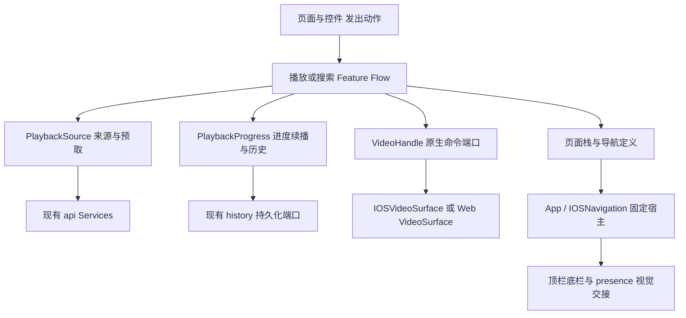

# HGViewer 重构计划与实施记录 H-20261112-3

状态：设计基线 H-20261112-2 已获 Civit 与 ExH 分别只读批准。本轮 H0–H4 实施及最终版本独立本地回归已完成。下文保留各阶段的边界与验收协议，实施结果见文末。只写 HG 仓库；安装与公开发布按对应产物的授权另行办理。

## 基线与目标

当前工程使用 React/Tauri；iOS由AVPlayer原生桥播放，桌面沿用Web播放器。1.2.2的连续变形已获用户真机验收。来源模块首轮提取已完成代码与独立前端验证，并随2×提示收窄修复进入1.2.3覆盖安装；设备版本/数据读回通过，自动启动因锁屏被拒绝，1.2.3体验尚待用户实测。

目标是让开发者能按一个功能找到状态、事件、实际副作用和清理位置。实施前 Feed 为1358行，并存播放来源、选集、进度/历史、手势、侧栏、详情评论和平台分支。以真实责任归属与可删除旧路径为验收，不以减少行数或增加hook数量为目标。

本计划保持现有交互、持久化格式、站点请求语义和下载调度；已接受的缺陷修复另列，不在拆文件时顺带改变行为。

## 已确定的 HG 架构

| 责任 | HG 当前/目标所有者 | 不应承担的工作 |
| --- | --- | --- |
| workspace、页面栈、RouteKey和来源 | store导航状态，App组合与挂载 | 不保存逐帧播放时间、不根据动画end提交收藏 |
| 内容选择、重试意图、播放意图、速率锁定、业务面板选择 | Feed的Playback Flow，分阶段变小 | 不建立第二套原生播放器、URL表或业务历史记录 |
| 本地优先、在线URL与邻集预取记录 | 已提取usePlaybackSource | 不决定自动播放、不记录历史、不请求转屏 |
| 时间、时长、一次性续播、节流/退出历史写回 | H1的PlaybackProgress | 不打开播放源、不拥有原生token、不执行导航 |
| 指针互斥、hold/scrub/edge判定和临时跟手状态 | H2的手势控制单元 | 不直接写历史/请求网络/改页面栈；只发明确命令 |
| 原生播放实际状态、命令与token关闭 | 现有IOSVideoSurface/原生桥；桌面VideoSurface | 不由提示图标计时器控制播放，不把route key当native token |
| 顶底栏固定、侧栏容器、安全区、页面presence | App/IOSNavigation及已有Sheet/finishMotion | 不复制业务panel选择；presence是实际退场阶段，不是另一份业务请求 |
| 方向请求与恢复 | 现有iosPlaybackOrientation队列和App播放范围判断 | 不给每个页面各建一个方向控制器 |
| 下载、分片、索引与清理 | 现有Rust offline/queue/transfer与原生后台层 | 生命周期不绑定Feed销毁；本计划不迁移这些服务 |

HG的页面呈现是React挂载与现有presence协议，不能为了模仿Civit的UIKit didDismiss再加一套空壳Presenter。RouteKey、业务playKey、源attemptKey和NativeToken分属不同层；同一内容重试不等于一次新的观看历史。

## H0 已完成：来源 owner

`usePlaybackSource`接管playUrls、cacheChoice、warmStreams，以及本地优先解析、元数据关联和450ms串行邻集预取。Feed仅提供当前选择、相邻候选、允许预取时机；重试调用invalidateCurrentSource，调用方不能改整个来源表。

删除：Feed中的三份来源状态、resolveStream/onlineSource helpers和三个来源相关effect。没有保留兼容副本。原有30秒预热有效期、顺序、错误文案和失效结果不发布保持。已发出的请求仍不支持主动abort；不把结构提取描述成新增取消能力。

验证：15项来源契约；浅/深各68项实际前端路由与18调用点；桌面两平台；4组模拟native IPC/历史；5个open token各close一次。证据在build/verification/playback-source。此验证不代替真实解码/后台或1.2.3真机体验。

## H1：进度、续播和历史归一个 owner

迁移Feed中的resumeRef、liveRef、lastSaveRef、historyPlayback，onTimeTick/onDurationTick内相关计算、实际onPlaying的首次记历史，以及active/playKey切换时的最终写回。新单元可以先保持一个usePlaybackProgress文件；只有纯逻辑测试或实际职责需要时再拆纯模型。

输入：当前业务内容身份、active会话代次、源attempt/listener身份、原有续播参数、真实playing/time/duration事件，以及现有addHistory端口。NativeToken仍归桥，不成为历史key；重试attempt用于拒绝旧事件，不重置本次active内容会话的首次记录标记。

输出：供UI显示的time/duration及明确的record/flush结果。续播采用同步调用协议：onDuration内计算并消费pending目标，经Feed连接的现有VideoHandle立即执行seek，再返回原生回调；可以是同步port或同步返回值由调用方当场执行，不能改成useEffect或异步命令队列。这样保留IOSVideoSurface的duration→seekRevision改变→抑制同snapshot旧time顺序。Progress不持有AVPlayer、NativeToken、路由或来源缓存。

保留语义：

- 只有真实onPlaying确认后才开始记录；范围是每次active内容会话，active/playKey切换复位，retry不复位。冷进入、准备源、单纯暂停退出不新增记录。Store仍按作品id去重、保留80部，不改成每集一条。
- 业务key为作品/集数，原生重试attempt另计；同一内容重试不能重复“首次播放”写入。
- onTime仍按原5秒窗口写回；active结束/内容切换时flush原内容，卸载兜底，不等视觉presence或finishMotion。dirty清零使重复cleanup幂等；失活或旧listener/attempt的迟到事件不能改最终位置、dirty或新内容。
- active=false时保留原暂停/续播行为；显式暂停后离开再回来仍暂停，不能仅因active=true就启动历史或自动播放。
- 每份pending续播目标只消费一次，保留t>1和距离片尾3秒的原规则。进入目标与iOS active=false保存的回来目标都保留，后者可生成新的pending目标，不因“进入时只一次”而被误删；恢复目标不自动改变显式暂停意图。native retry restore与离线修复seek仍归桥，计数与Progress续播seek分开。

删除：Feed中的旧四个ref及重复历史/续播处理；Feed只连接Progress事件和原播放器命令。禁止新旧两套并写历史。

验证：从未播放退出、真实首播、重复playing、pause离返、同key重试、跨集/跨剧、迟到time/duration、切active/卸载双cleanup、0时长/片尾/重复duration。固定三条事件序列：playing→time→retry→playing；duration→同步resume seek→同snapshot旧time；A失活→迟A事件→B激活但尚无B playing。分别比较addHistory、Progress续播seek、native retry/修复seek的对象、次数和时序。再走在线/缓存和桌面实际入口。若baseline违反上述契约，单独登记缺陷，不能把行为修复藏在结构提取内。回退为H1完整变更，不影响已完成H0来源单元。

## H2：一个指针仲裁器，分清瞬时手势与持续意图

迁移onDown/onMove/onUp/onLostCapture、gesture/timer、hold/scrub/edge临时状态与取消逻辑。长按、拖进度、边缘切集继续共用一个互斥决策，不能分成几个同时争同一指针的hook。

持续speedLock与基准rate仍属于Playback Flow；临时hold/lockArmed、pointer capture、速度采样和阻尼属于手势单元。手势只发toggle、seek、stepEpisode、holdRate、requestSpeedLock等明确命令；选择哪集、是否锁速由Flow接受。原生pull/slide是Platform视觉命令，历史仍由Progress处理。

保留：首末集阻尼、双侧边缘、安全区、64px上滑锁定、取消不提交、长按释放恢复、切源/页面失活/旋转清理、synthetic click抑制。指针和timer按当前实例清理，不取消其他控件的动画。

删除：Feed中旧指针状态和handler；不能保留第二个window listener或hold timer。H1完成后才迁移H2，避免同时改历史写入与指针提交时机。

## H3：面板和展示从播放组合中移出

先提取详情/选集/评论的视图子树与既有动作接口，业务requestedPanel仍由Playback Flow单独持有；Sheet的实际presence/关闭过程保留在现有表现层，lastDetailPanel等退出快照内容按原身份保留。不能把requested与present合为一个Bool，也不能为每个新View复制一份panel状态。

IOSPageBar仍声明到已有固定宿主，不能出现第二套顶底栏。桌面Dock与iOS整页保留各自展示方式。关注/登录/缓存/跳作者/选集等动作走原业务入口，拆子树不重复请求内容或创建播放器。

验证：详情/评论往返、nested login、切集、焦点交回、来源tab、快开快关、退出中重开、ReduceMotion、左右横屏。新组件接入全部实际分支后删除Feed原子树。

## H4 按具体收益整理导航/Store和样式

保留workspaceTabs导航定义和现有App路由入口。先检查同一返回原因是否真的分叉，再引入需要的typed intent；简单回调不为形式统一而加框架。store当前是公共facade，可逐项把history纯策略/收藏同步移到明确模块，保持公共API和持久化单一来源；不无证据地一次拆成多个相互同步的Context。

ios.css按尺寸角色、导航、设置、播放器和弹层整理。保持选择器优先级与导入顺序，先合并已证实的重复/覆盖，再评估分文件；不在H1/H2中混入全量CSS整理或尺寸调整。已有方向队列先保留，只有新的实际场景需要时再改其scope。

## 分阶段验收和交付

每个阶段先绑定源码与实际入口，再做纯状态/事件测试、真实前端+模拟桥路由、相关平台验证。素材和页面数量、后台任务与缓存数据保持；失败、取消、迟到结果和不确定写入分开。视觉改动检查中间帧，结构改动比较副作用次数和生命周期，不把构建成功当运行证明。

H1–H4 按下列责任单元完成实施，保持各阶段独立回退。每阶段冻结自己的具体接口并保留完整回退；实质偏离本计划时再交三方复核。安装与发布按用户对对应产物的授权办理，不由架构认可自动触发。

## 审阅要求

请Civit与ExH只读评审同一修订H-20261112-2，分别给通过/附条件通过/不通过，重点挑战：职责与identity是否仍有双owner、H1是否过大、H1历史与seek语义是否足够明确、H2持续意图与瞬时手势边界、HG是否错误照搬UIKit生命周期、缺失验收场景。本修订已获两边通过；H1实施后仍需副作用顺序、真实入口与平台验收，计划通过不替代实现或装机验证。

## 评审记录

- 修订1：Civit对实际源码只读复核后附条件通过；要求明确active内容会话与retry身份、duration同步seek/同snapshot旧time抑制、旧listener结果拒绝、active结束即flush和返回续播目标。四项已纳入修订2。
- 修订2：ExH已完整只读并对照实际源码，明确通过、无H1方案阻断；补充未playing/无duration取消不写空历史等为实施验收。Civit实际回读并结合独立终审，最终明确通过，替代修订1附条件结论。该次方案评审时 H1 及以后尚未实施；后续实施结果见下。

## 本轮实施结果

| 阶段 | 最终所有者与改变 | 本地验证 |
| --- | --- | --- |
| H0 | `usePlaybackSource`：来源解析、本地优先、邻集预取；原生 token 仍归桥 | 上轮15项来源契约与真实前端模拟桥已通过，本轮消费者继续回归 |
| H1 | `usePlaybackProgress`：时间/时长、一次性续播、5秒节流、失活最终历史；Feed连接同步seek端口 | 独立15项契约、另一次13项生命周期审核；生产Feed模拟桥含同步resume与同snapshot旧time抑制 |
| H2 | `usePlaybackGestures`：画面/侧栏/进度条共享一个pointer owner；Flow保留rate/speedLock与145ms切集 | 独立10项组合契约、额外真实Chrome pointer capture与审阅；已删除Feed旧ref/handler/listener |
| H3 | `PlaybackPanels` 与模块级 `ShowDetailContent`：展示子树；requested/lastDetailPanel/presence/controller/focus仍归Feed | 独立逐段对照及评论→登录→返回同DOM/不增加请求；详情→选集实际渲染；最终浅/深色136项路由、18处声明、横竖屏六组手势与跨平台入口通过 |
| H4 | `watchHistory`纯策略；缓存管理close→push单入口；详情tab共用定义；桌面social按钮补可读名称 | 14项历史断言+独立Store facade审阅；跨平台入口回归 |

Feed 从1358行收敛到951行。收益是来源、进度、临时手势、面板展示与持久化规则可以分别定位；代码总行数不是验收指标，身份防护和回归用例会增加少量代码。

H4没有新增通用导航框架或拆多个Context。现有workspaceTabs已是单一导航定义，方向队列有明确平台职责；没有实际重复证据支持再包装。ios.css的固定宿主、ghost与live layer承担不同职责，不能按相似外观盲目合并。本轮保持样式产物一致，保留现有优先级与尺寸。

明确行为修复：H1拒绝退休/失活事件覆盖结束快照；H2处理pointer身份、timer归属、lost capture、失活/布局清理与首页异步容器监听。同一owner未结束前不接受第二个primary pointer，避免暂停/seek意图被抢占。纵向14px后的原识别规则保持。

验证记录在本地 `build/verification/playback-progress`、`playback-gestures`、`playback-panels`、`history-policy` 与 `refactor-closure`。它们区分真实前端、模拟IPC、测试夹具失败和原生/设备验收；本轮不把浏览器通过表述成AVPlayer真机验收。

H4 最终审阅额外复现了既有顶栏命中缺陷：分栏按钮 pointerdown 时清理旧 morph 会同步改变命中区域，mouseup 落到 group 而吞掉 click。修复只将分栏按钮接管移到 click capture（目标已固定），正文 swipe 与键盘保留原接管；没有改分栏 select/available 或新增点击队列。独立真实 React/Chrome 全 App 已通过 mouse×3、touch×3 的立即点击与拖出不提交检查。前期的早点击失败保留为 before 证据，不以延长等待覆盖它。

最终综合回归绑定 `index-dR1AH3Yi.js`（SHA-256 `9c4674ee19ad99b32087cbcd5b2c071a66a62f5de4df692b566ec08958d700bf`）与未变样式 `index-BX5hVnO-.css`。独立总报告为 `build/verification/playback-panels/independent-summary.json`，状态 passed；顶栏快速点击 before 失败记录另存。当前完成范围为源码与本地浏览器/模拟桥验证，不包括本轮新的手机覆盖、原生解码验收或GitHub发布。
