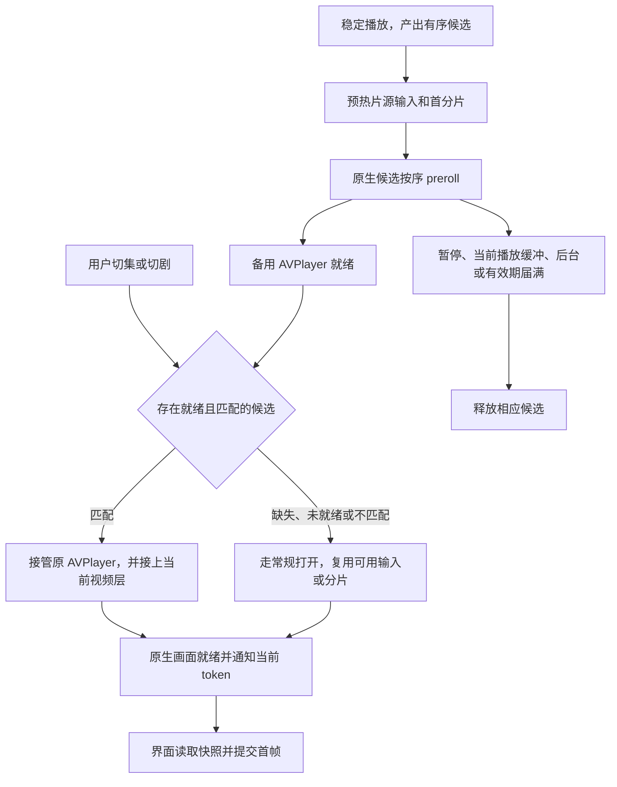

# iOS 播放链路设计

首页刷剧、剧集内切集和缓存播放共用 iOS 播放表面。切换速度由片源准备、媒体传输、原生画面就绪和界面提交共同决定。每一步用自己的计时定位，首分片命中与原生播放器接管分别记录。

## 模块职责

| 模块 | 持有的状态和决策 |
| --- | --- |
| [Feed.tsx](../src/components/Feed.tsx) | 当前剧集和集数、播放意图、候选优先级及控件。资料库的缓存播放也从这一层进入。 |
| [usePlaybackSource.ts](../src/components/usePlaybackSource.ts) | 本地优先的片源解析、按线路版本隔离的地址记录和邻近候选调度。来源失效时仅清理当前项。 |
| [usePlaybackProgress.ts](../src/components/usePlaybackProgress.ts) | 显示进度、续播位置和观看历史写回。历史以实际播放为起点。 |
| [IOSVideoSurface.tsx](../src/components/IOSVideoSurface.tsx) | 把原生快照转换为画面和控件状态。持有当前 token、首帧通知、轮询和一次原生恢复预算。 |
| [iosPlaybackDiagnostics.ts](../src/components/iosPlaybackDiagnostics.ts) | 定义启动诊断字段并输出受控日志。画面就绪、轮询和恢复决策由播放表面持有。 |
| [ios_player.rs](../src-tauri/src/ios_player.rs) | 处理 Tauri 命令，协调原生打开、当前会话及 WKWebView 主线程调用。 |
| [ios_player/preload.rs](../src-tauri/src/ios_player/preload.rs) | 管理输入预热中的等待（`pending`）、可接管（`ready`）和前台打开（`opening`）状态，以及有效期与取消。 |
| [ios_player.m](../src-tauri/src/ios_player.m) | 管理主线程上的 AVPlayer、AVPlayerLayer、备用播放器和首帧观察。 |
| [ios_media.rs](../src-tauri/src/ios_media.rs) | 创建仅绑定回环地址的媒体代理，改写 HLS 路径，处理 Range 请求，持有播放会话的代理任务与缓存读取租约。 |
| [net.rs](../src-tauri/src/net.rs)、[network_policy.rs](../src-tauri/src/network_policy.rs) | 统一管理上游 HTTP 客户端、目标检查、DNS 固定、重定向验证和网络请求并发。 |
| [watch.rs](../src-tauri/src/watch.rs) | 管理观看过程中的临时分片、记录名额和写入预算。 |
| [watch/streaming.rs](../src-tauri/src/watch/streaming.rs) | 核对首个 TS 响应的流式条件，转发分块，收齐后把完整响应交给观看缓存写入器。 |
| [offline.rs](../src-tauri/src/offline.rs) | 管理显式缓存任务与已提交的文件。持久化和迁移细节见[单文件缓存设计](offline-single-file.md)。 |

业务层用剧集 ID 与集数定位内容。原生 token 只标识一次播放器打开，重开也会分配新 token。原生预热输入按片源、线路与安全模式匹配，播放器接管再核对同一个本地代理地址以及候选是否就绪。三个身份各有用途，便于避免跨剧、跨请求或跨线路复用。

## 片源准备与切换

短剧先查询当前集的本地缓存。已提交的 MP4 由原生文件路径打开，旧版 HLS 缓存走回环代理。原生读取当前缓存元数据决定存储格式，读取租约覆盖正在播放的文件与切换交接。在线短剧解析地址后使用同一套目标检查和播放列表改写。

iOS 播放稳定后，来源模块等待 450 毫秒再按序准备候选。首页先准备下一部剧，再准备下一集。剧集详情先准备下一集，再准备下一部剧。两个向前候选都可申请首分片预取和备用播放器。原生输入预热最多保留四份就绪输入，普通有效期 30 秒，同时最多准备两份。备用 AVPlayer 属于当前播放 token，至多两个，按序执行 `preroll`，保持暂停、静音，通常在 12 秒内消费或释放。



| 切换时的候选状态 | 前台动作 | 生命周期约束 |
| --- | --- | --- |
| 备用 AVPlayer 就绪且匹配 | 接管备用播放器，应用当前播放意图 | 原生层核对播放器会话与本地代理地址 |
| 备用播放器未就绪，输入已就绪 | 复用输入并常规打开 | 领取输入后，迟到的预热回调须核对就绪记录 |
| 匹配的输入还在准备 | 最多等待 180 毫秒，超时取消对应任务并由前台准备输入 | 取消和发布按同一预热任务身份核对 |
| 原生代理命中仍在下载的同一首分片 | 最多等待 120 毫秒，超时取消该分片的预取并发起前台请求 | 仅等待 URL 完全匹配的首片 |
| 没有匹配输入 | 常规打开 | 迟到的状态通知和关闭请求继续按播放 token 隔离 |

两个等待预算分别约束输入与首分片，遇到同一次切换时可以先后发生。端到端首帧另包含上游响应与原生解码。

## HLS 数据交付与缓存

原生代理把上游播放列表和分片改写为带会话路径的本地地址。分片预取只面向有固定结尾且首片独立的 HLS 列表。从主列表预取时选第一条声明的清晰度，AVPlayer 自己选择实际清晰度。请求与预取目标完全匹配时才复用。单个预取最多 4 MiB，最多等 3 秒，同一时刻只有一个首片预取，未消费的字节 30 秒后释放。

流式转发用于启动阶段尚未命中缓存或预取的普通 TS 分片。请求必须来自有效观看会话，并命中播放列表登记的媒体 URL。上游须返回完整的 HTTP 200、`video/mp2t` 和已知长度，长度最多 16 MiB。代理在读取首块之前保存原始响应长度，并在收到首个有效数据块后开始交付。下游 Content-Length 和完整性检查共用这个长度。准备失败沿用原请求的重试预算。其他响应沿用缓冲与播放列表改写路径，已经打开的上游响应可继续读取。

流式响应在送出分块时持有网络与记录名额，最多累计到声明长度。收齐后才交给观看缓存写入器，写入器核对会话、预算和磁盘状态。源文件截断、传输出错或播放器提前断开会终止未完成的累积。正式的离线任务、续传和单文件提交由离线模块独立负责。

## 首帧通知、轮询与恢复

AVPlayerLayer 的首帧观察在已验证的当前播放器上发出带 token 的 `hg-ios-first-frame`。Web 层收到通知后唤醒状态读取，由快照确认画面是否就绪，通知与已有读取合并。200 毫秒轮询继续更新播放状态、进度和恢复逻辑，并覆盖通知早于命令返回或 WebView 不可见时的情况。

回前台时重新应用播放器几何，并按原播放意图恢复。曾显示画面的会话仍缺帧时，Web 播放表面在宽限期后发起一次 seek，持续异常时可重开一次。首帧后，页面可见且会话处于主动播放时，缓冲长期无进展也进入同一套一次重开流程。重开从保存的位置恢复，在线地址需要刷新时由来源模块重新解析。手动暂停状态随恢复流程保留。

## 诊断口径

| 字段 | 如何解释 |
| --- | --- |
| `selectionToFrameMs` | 从页面选择到 Web 播放表面确认并提交可见首帧。首帧失败或原生重开的样本另看恢复事件。 |
| `nativeStandbyHit`、`firstHlsMediaPrefetchHit` | 前者记录备用 AVPlayer 接管。后者记录首个媒体响应复用已预取的字节。 |
| `openMs` | 从 Web 发出打开命令到收到原生返回，包含输入准备、调度和播放器切换。主线程排队、旧播放器关闭与新层接入用对应的原生子字段判断。 |
| `nativeReadyToStatusMs` | 原生画面层就绪到 Web 发起的状态读取被原生采样的时间。`nativeFirstFrameWake` 标记首帧事件是否唤醒过读取。 |
| `firstHlsMediaStreamed`、`firstHlsMediaResponseMs` | 流式命中时度量首块可交付的时机，普通缓冲响应度量资源可交付的时机。区分两种模式后再比较。 |
| 网络阶段字段 | 分别记录并发槽排队、响应头、首批数据、剩余传输和请求次数。流式首帧样本可能早于整个分片结束，缺失的阶段保持缺失。 |

1.2.21 有一条备用播放器接管的真机样本用时 464 毫秒，其中打开命令约 240 毫秒，原生就绪到状态采样约 145 毫秒。同轮本地缓存播放用时 462 毫秒。另两次在线冷启动用时 1.80 和 1.91 秒，等首分片响应头分别花了 505 和 1,022 毫秒，剩余传输约 341 和 368 毫秒。这组数据用于选择改动点，样本量不足以估算平均收益。1.2.24 已验证安装与启动。首帧收益仍需用同一线路和内容的新版真机日志核对。

诊断只记录场景、状态、耗时、计数及受控错误分类。播放地址、授权参数和用户数据留在运行时。

## 回归与真机验收

```sh
pnpm build
pnpm test:browser playback-source playback-recovery playback-progress playback-gestures route-context
cargo test --manifest-path src-tauri/Cargo.toml --lib
```

- 浏览器用模拟的原生状态验证本地优先、过期任务隔离、候选顺序、当前 token 唤醒、暂停与观看进度恢复。首帧后长时间缓冲的恢复行为仍需在真机上复核。
- Rust 使用真实 TCP 响应覆盖首块包含整个分片、两块组成完整分片以及中途截断，核对转发长度、数据与错误。测试还覆盖流式响应的 MIME、Range 和大小条件。真实 CDN 的重试与观看缓存落盘需要在线验证。
- iPhone 上用同集、同线路各测冷启动、向下一集、刷下一部剧、缓存播放、从后台恢复。记录切换到首帧、首分片交付、候选接管和开播后卡顿，同时检查当前播放是否被预热带来的流量拖慢。
- 覆盖安装从当前设备版本读回和数据清单开始。安装后核对实际运行的新版、缓存和下载队列。安装通过与播放性能验收分别记账。
