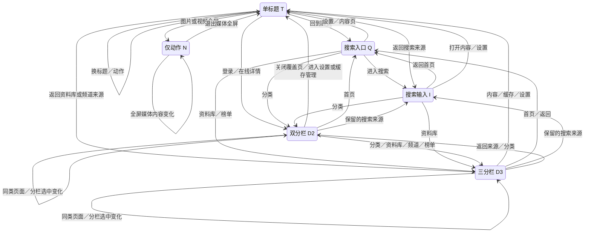
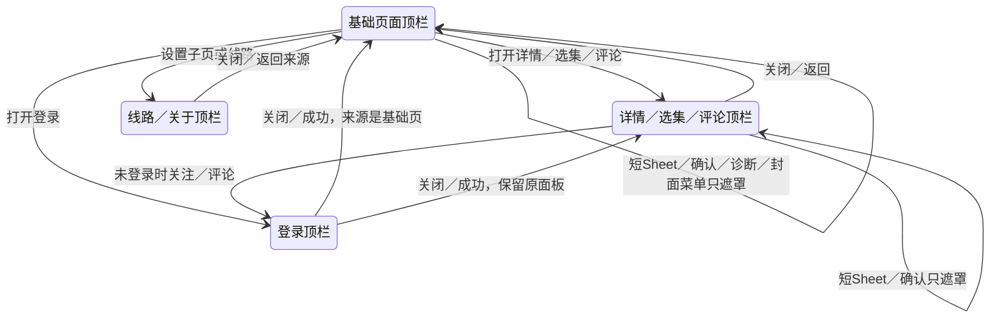
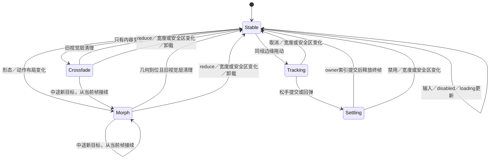
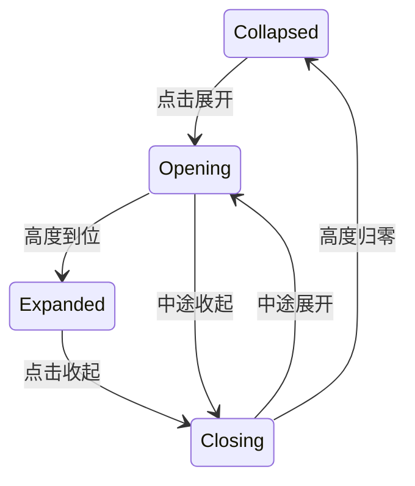

# 固定导航的状态与转场

2026-11-12 · 1.2.0 候选实现与验证基线。组件实现、状态矩阵与独立审阅已完成；最终 iOS 前端已通过浅色68项、深色68项实际路由检查，18/18处顶栏调用点均观察到。该检查运行于Chromium与模拟原生接口，真机WebKit和系统交互验收单独记录。文中的时序为设计值，运行结果以对应验证记录为准。

## 目标与固定边界

视觉上保持现有深浅材质、尺寸与单一强调色；导航留在原位，内部空间与内容连续交接。正文仍按原有页面手势移动。顶栏形态、动作和选中反馈各司其职，不为页面增加装饰性入场。

顶栏 host、底栏、左右按钮锚点不随页面动画移动；操作目标高44、可见面高36、字形和字号不缩放。物理旋转或安全区变化时，导航按新视口重新布局，不能为保留旧坐标而进入刘海区域。`fillTrailing` 只扩展背景，不让标题偏离中心。

## 形态图

所有实际页面映射到以下六种形态。箭头描述动画组件具备的交接能力；页面能否直达仍由现有路由决定，不增加入口或返回路径。

同类型不意味着重播整栏：只切同一组分栏的选中项时，由 `IOSTabSwipe` 驱动指示器和正文；顶栏形态不变。搜索输入值变化、清除词、刷新loading、按钮禁用只更新对应控件，不触发整栏交接。

## 覆盖层与唯一所有者

覆盖页按实际已发布的顶栏确定唯一 owner：全局登录优先于内容 overlay，同层使用最后有效发布的顶栏，否则使用当前基础页。只有 owner 绘制、响应输入并决定顶部材质；关闭后恢复下层原实例。旧内容视觉层不属于 owner，不带 `.hg-ios-floating-bar` 或 `data-overlay` 身份。

两个容易误画的实际路径：在线详情进入缓存管理前会先关闭详情，因此缓存管理返回原播放基页；评论打开登录保留评论面板，登录关闭后恢复评论。短清晰度Sheet、诊断／确认框、封面菜单不发布新顶栏，只处理原导航的遮罩和输入隔离。

## 时序与内部空间

| 转移 | 背景与空间 | 内容 | 选中块与动作 |
| --- | --- | --- | --- |
| 首次出现 | 直接使用目标几何 | 直接显示，不从空白重播 | 使用目标状态 |
| 单标题换标题／同类动作换内容 | 背景保持；确有尺寸变化才插值 | 旧内容退出、新内容交叉淡入，总计200ms | 同一次开始时间；按钮不能晚于标题出现 |
| 标题、搜索、双／三分栏互换 | 真实left/width插值约240ms，固定高36/R8；不用scaleX | 旧内容0–120ms慢起淡出，新内容60–240ms淡入；字体不缩放 | 指示块随结构显现或收敛；动作与正文槽共用时钟 |
| 左右动作增加／移除、fillTrailing变化 | 中间表面平滑让出或接收空间 | 只调整内部内容的实际位置，不移动栏host | 动作在固定锚点淡入／淡出，点击目标仍44 |
| 同组分栏选中／循环 | 外框不变 | 正文跟手，松手提交或回弹 | 原指示器跟手；保留终帧到索引提交，禁止另起整栏淡入 |
| 搜索入口变真实输入 | 保留同一中间表面并衔接宽度 | 入口文字交给真实输入；live input不能用快照替代 | 输入焦点和值独立于动效；不能重复提交 |
| 标题变仅动作、反向恢复 | 中间表面退出／恢复，左侧锚点不变 | 仅对应内容退出／进入 | 只保留实际可用动作 |
| 普通与播放背景切换 | 在持久host上插值材质约200ms，避免旧页白底泄露 | 不因色板变化重挂载内容 | 上下栏材质均在原位变化 |
| 底栏选中变化 | 容器、三项位置和14图标框固定 | 文字颜色200ms过渡 | 常态／选中图标原位交叉淡化200ms，无位移 |

空间变化只作用于表面几何、内部位置、指示器宽度和留白。字体、图标、圆角半径与44高的真实点击区域不按比例变形。底栏目前始终为首页、分类、资料库三项，页面stack保留来源tab；不能凭空设计“评论底栏替换成另一组菜单”。

分栏按钮的点击接管在 document click capture 完成：此时浏览器已确定目标，再收敛旧顶栏动画，然后由原按钮 handler 切换。不能在该按钮的 pointerdown 中同步清 transform，否则按钮会移出 pointerup 的坐标，click 退化为父 group。正文分栏边缘拖动仍在 pointerdown 接管，保证后续跟手坐标从稳定几何计算；键盘沿焦点目标接管。不合成 click、不重放点击，也不让按下后拖出按钮的操作提交。

## 动画生命周期

首次有效顶栏发布时直接解析目标形态和材质，再启用后续过渡；空host先挂载不等于首次有效发布。

仅保存当前live槽、上一份只读视觉快照、几何和本动效的句柄。快速A→B→C必须从屏幕正在呈现的位置与透明度接续；连续切换不重复等待入场，透明副本不保留，达到上限时先清最透明层；旧回调不能清掉新状态。只取消本动效持有的句柄，不能遍历取消整个子树的动画，以免破坏分栏跟手终帧。

快照继承当前host色板，保留作者语义样式，不缓存过渡起点的计算后墨色；快照统一inert、aria-hidden、pointer-events:none，清除ID、form/name/autofocus及业务data标记；结束、resize、reduce、卸载都释放。live输入节点、selection与IME组合输入保留。仅键盘高度变化不应重新挂载输入或重播顶栏。减少动态效果时立即到位，不保留过渡快照。

## 页面与模板覆盖表

以下来自全部18处 `IOSPageBar` 调用点；一个调用点可承载多个页面状态。具体源位置由 `build/verification/chrome-motion/page-coverage.json` 绑定。

| 实际页面／模板 | 中间形态 | 左／右动作 | 必测路径 |
| --- | --- | --- | --- |
| 首页：加载、成功、空、失败 | Q搜索入口 | 榜单／账号 | 首页↔搜索、分类、资料库、设置；播放色板保持 |
| 搜索：未提交、结果、空、失败、键盘、清除 | I真实输入 | 返回／账号 | Q↔I、I↔结果播放、输入↔设置；打字不重播 |
| 分类频道／发现 | D2 | 榜单／账号 | 首页↔分类、分类↔频道、分类↔榜单、同组循环 |
| 频道排序 | D3 | 返回／账号 | 分类↔频道、频道↔播放、排序循环及分页 |
| 排行榜 | D3 | 返回／账号 | 首页或分类↔榜单、榜单↔播放；搜索无iOS榜单入口 |
| 资料库收藏／历史／缓存 | D3 | 最近播放缓存／账号 | 三栏循环、空／加载／失败、卡片↔播放／缓存管理 |
| 在线上下文播放 | T剧名 | 返回／选集 | 来源↔播放、播放↔详情／选集／评论、剧集之间换标题 |
| 缓存播放 | T离线播放 | 返回／选集 | 资料库／缓存↔播放、播放↔离线详情／已缓存分集／评论 |
| 在线详情／选集 | D2 | 返回／缓存动作 | 播放↔D2、详情↔选集循环、D2→缓存管理→原播放 |
| 离线剧集详情 | T | 返回／缓存管理 | 播放↔离线详情、详情→管理→原播放 |
| 已缓存分集 | T | 返回／排序 | 播放↔已缓存分集、排序不重播全栏 |
| 评论（活跃剧集入口） | T | 返回／刷新 | 播放↔评论；评论↔登录；刷新loading不重播 |
| 缓存总览、某剧管理、最近播放缓存 | T | 返回／账号 | 资料库↔缓存、管理↔播放、清理确认仅遮罩 |
| 设置 | T | 返回／关于 | 任意有效入口↔设置；主题切换只过渡材质 |
| 登录／注册：空、提交、错误、键盘 | D2 | 返回／登录或注册提交 | 设置／评论／详情↔账号、分栏循环、提交动作同步 |
| 线路 | T | 返回／查找线路 | 设置／首页失败↔线路，检测状态不重播 |
| 关于 | T | 返回／复制 | 设置↔关于、复制反馈不重播 |
| 图文列表 | T | 返回／账号 | 分类↔列表、列表↔详情 |
| 图文详情 | T，右背景扩展 | 返回／无 | 列表↔详情、文章之间切换、媒体全屏 |
| 全屏图片／全屏内嵌视频 | N无中间栏 | 退出全屏／无 | T↔N、切媒体、退出恢复原标题与表面宽度 |
| 清晰度短Sheet | 不更换原顶栏 | 关闭在Sheet内 | 播放→Sheet→原播放，原导航输入隔离与恢复 |
| 确认／诊断框 | 不更换原顶栏 | 弹窗内动作 | 打开／取消／完成恢复，不能被快照抢焦点 |
| 封面长按菜单 | 不更换原顶栏 | 菜单内动作 | 浮起／关闭／归位，导航不重播、不留克隆 |
| 播放清屏／旧fs状态 | 可见↔隐藏 | 按原功能显示 | 仅透明度显隐；恢复原位，不从屏外滑入 |

原生系统选择器、系统状态栏与外部网页不由本动效接管。桌面Chrome/侧栏和Android分支保留平台布局，须确认iOS样式与新DOM结构不泄露到它们。

## 设置页的原地展开

「播放侧栏」是当前设置卡片内的展开区，不发布新的顶栏。收起时显示向下箭头，展开时向上，箭头和内容高度同步过渡240ms；内容透明度200ms，减少动态效果时直接到位。列表始终保留同一实例，快速反向从当前高度接续，避免重置开关或排序状态。

收起后列表及恢复默认操作为inert，焦点回到展开按钮；点击区仍使用现有52高单行标准，列表项44高、间隔4，卡片外框不额外叠加内边距。清空历史、清理缓存和网络诊断是就地操作，保留原有确认／诊断框，不显示进入下级页面的箭头；移除无操作意义的收藏与历史统计行。设置组内整行按压只改变背景，保持整行和分割线几何不变，独立控件保持自身反馈。

## 验证与发布

组件用例覆盖六种形态的每个正向／反向组合及左右动作0↔1；路由用例再核对上表实际存在的边。记录起点、中点、终点：host和bottom矩形不变、表面真实宽度连续、旧新内容同时交接、字号不变、无scale/clipPath、ghost结束归零。覆盖快切、反向返回、overlay叠overlay、旋转、左右安全区、仅键盘高度变化、reduce和卸载。

分栏原有六组跟手、首尾循环和106消闪回归必须保留。搜索输入需核对焦点、caret、IME、清除和单次提交；评论与详情进出需核对焦点归还。实际WebKit伪元素动画与系统键盘仍以真机结果为准。

发布1.2.0需绑定最终源码、版本清单、包内资源及回归结果；未验证的新动效不应混入已验收109的结论。GitHub公开包继续为未签名IPA，重新下载校验后再清理本地构建垃圾。

来源补核：`CommentsPanel` 虽支持post类型，但当前真实图文入口 `Posts/PostDetail` 没有评论调用；图文评论只列兼容分支，不作为已运行的实际路由。
