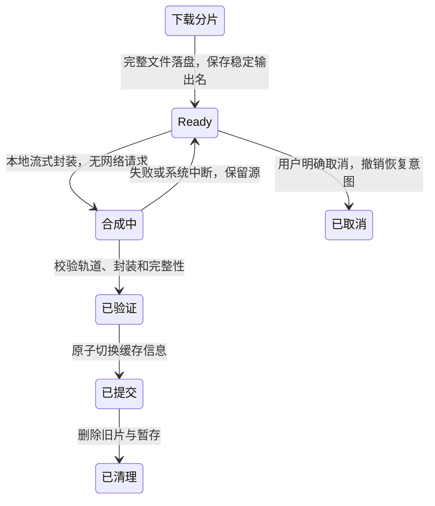

# 单文件缓存与旧缓存迁移

2026-11-13。此单元服务于 iOS：新分片下载在本地封装为单个 MP4 后提交；旧缓存逐集迁移。桌面保留既有下载实现，并能读取新的命名元数据。本轮不增加导出界面，命名后的单文件为后续导出提供直接来源。

## 完成的含义



下载齐全不等于缓存已完成。`Job.finalizing` 在封装期间维持后台任务和暂停能力；界面显示“合成中”，隐藏不再有意义的网络速度／ETA，进度暂留 99%。只有文件及元数据提交成功后，才计入已缓存集数。

## 文件与身份

`Episode.media_file` 是可选 basename。旧 JSON 缺少字段时，继续按 `mp4` 读取 `video.mp4` 或 `index.m3u8`；新文件使用 `剧集名_第N集_时间戳.mp4`，删除路径分隔符／控制字符，限制 UTF-8 长度。时间戳使用 Unix 秒：新下载取完成时间，旧缓存取原信息文件修改时间；写入 ready 后固定，不随重试变化。

对外仍使用 `/offline/{id}/{ep}/video.mp4` 逻辑地址；后端根据权威元数据映射命名文件，不向服务接口开放任意路径。native 播放也读取后端元数据，不信任前端旧快照的 `mp4=false`。

新版本读取旧缓存兼容；旧版不认识 `media_file`，不能把直接覆盖旧二进制当作已验证的无损回退。回退应保留新格式读取支持，或先将命名文件恢复到 `video.mp4` 并原子更新相应信息，再安装旧版。交付保留签名包、源清单和验证记录；不会为回退清空缓存。

`offline_files` 拥有命名、ready、原子 JSON 切换及已知旧文件清理。清理只删除旧 playlist、数字分片和旧 `video.mp4`，保留指向的新文件及其他未知文件。旧 MP4 使用硬链接再切元数据，避免复制整集。

## 新下载与恢复

`commit_episode` 在完整包形成后持久化 ready，并在同一 queue 锁下把完整 capture 提升为普通可持久化单集任务。完整 show 选集范围在开始传输前保存。重试优先处理 ready；本地选集已齐时不再请求接口、清单或分片。

系统中断可恢复，手动暂停仍保持暂停。手动取消先撤销 ready 恢复标记，再持久化移除 pending；同一锁下的旧 worker 不能把已取消、无新授权的 ready 写回来。正常取消返回后即使没有执行 worker 收尾，冷启动也不会恢复该任务。中途文件系统失败和未返回命令不是成功取消；这里不宣称突然断电时跨文件事务原子性。

watch key 是进程内身份，ready 不序列化它，避免重启后误删另一个同号播放会话。当前进程的成功提交仍可清理对应 watch 临时缓存。

## 迁移与播放所有权

旧缓存串行处理，完整源保留到单文件通过验证、`info.json` 原子替换之后。输出已写好但未切信息时，可验证复用；信息已切但清理未完成时，只补清理，不重新封装。显式 discontinuity、codec 配置变化或损坏输入会保留旧包并记录固定原因，不制造可疑单文件。

`Cache` 的 reader lease 与转换 reservation 保护源文件。播放／预加载先取得 lease，再读元数据；`Sessions` 持有当前及待替换 reader，直到主线程 native 替换／关闭实际返回后才释放。Gateway 连接也持有 reader。迁移提交前再次检查 readers；正在播放的集延后处理，删除也会拒绝正在使用或转换中的集。

旧迁移仅在前台进行，后台取消后留待恢复。运行中的迁移收到新的前台恢复请求会记录 `restart_requested`；取消的集进入 deferred，避免快速前后台切换遗漏。已知不兼容内容本轮不反复循环重试。

## 原生引擎与验证

`offline_remux` 限制同时一个本地封装；blocking worker 持有原生句柄及 semaphore 到实际返回，停止会发送 atomic cancel 并等待结束。`HGRemux` 是可替换的 LGPL 动态 framework，精确版本、构建与源代码交付见[引擎说明](remux-engine.md)。它不重编码、不联网、不删除输入。

进程异常结束留下的私有输出，只在获得该集转换所有权后清理：严格匹配当前稳定文件名的 `.hgremux-` 六位随机后缀及普通文件类型，保留其他输出、目录和软链接，不抢删活跃 writer。

常规回归使用 host Rust 单测与 `pnpm test:browser`。iOS 官方预编译标准库没有 libtest，实际组合回归使用 opt-in 的 `storage-integration` example，直接调用生产存储与 session owner：

```sh
cargo build --manifest-path src-tauri/Cargo.toml \
  --example storage_integration --features storage-integration \
  --target aarch64-apple-ios-sim
```

在已启动的 simulator 中运行该可执行，传入绝对本地 HLS fixture 路径，并把 `DYLD_FRAMEWORK_PATH` 指向 simulator framework 切片。此 feature 默认关闭，不随正式 App 启用。它覆盖 ready 冷启动、输出验证复用、原子提交后清理、重命名播放地址、reader／token 生命周期及不兼容保源；实际 AVPlayer 和真机安装另行验证，不用 host 通过代替。

重建 iOS 项目前先运行 `python3 scripts/build-remux-ios.py`。`tauri.ios.conf.json` 声明 framework 和许可证资源；`Info.ios.plist` 保存后台／方向配置，避免重新生成工程时丢失。公开发行须同时提供与该 framework 对应的 source packet；个人签名资料不进入公开包。
